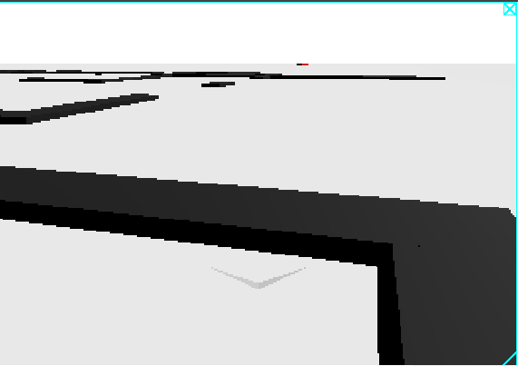
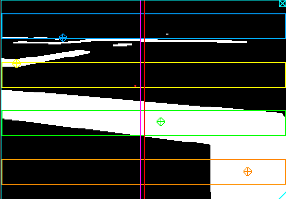

# English
## Deterministic Controller (Deterministic_controller folder)
### Introduction
The idea is to use a deterministic controller.

The core of this method is that a grayscale mask is applied to the image and four horizontal zones (<a id="ROI"></a>**ROI**: Region Of Interest)) are created.

Within the simulation, if the displays are enabled, you can see separately:

| Before (Without Mask) | After (With Mask) |
| :---: | :---: |
|  |  |

### Masked Display
#### Elements Inside

The rectangles:

- Blue.
- Yellow.
- Green.
- Orange.

These are the Regions of Interest discussed above.

The targets of the same colors are the centroids of the black color within the regions.

The red and purple vertical lines represent the center line and the error line, respectively, and are calculated as:

- Red line:

    $$
    x_{RL} = \frac{w_C}{2}
    $$

    where:

    - $x_{RL}$: x position of the red line;
    - $w_C$: Width of the Camera in pixels

- Purple line:

    $$
    x_{PL} = x_{RL} + \epsilon
    $$

    where:

    - $x_{PL}$: x position of the purple line;
    - $\epsilon$: is the weighted error derived from the centroids calculated as:
    
        $$
        \epsilon = \sum_{i=1}^4 {\epsilon_i*weight_i}
        $$

        where:
        - $\epsilon_i$: is the error of the centroid of the single region;
        - $weight_i$: is the weight used for the single region. By default, the values are set as

        |Blue Zone (Top)|Yellow Zone (Upper Center)|Green Zone (Lower Center)|Orange Zone (Bottom)|
        | :---: | :---: | :---: | :---: |
        |0.15|0.25|0.25|0.35|

You can find the calculations in the functions:

- `find_centroid()`;
- `compute_final_error()`.

#### How is the mask created?

**(Dunno, I'll check now)**

Acquires the image ➔ Converts to a BGRA array ➔ Converts to grayscale (by averaging the RGB values)

You can find it in the function:

- `get_gray_image()`

### Steering Calculation

The steering calculation is handled by a PID (Proportional-Integral-Derivative) controller. For those who don't know:

$$
\begin{align}
P &= K_p*\epsilon \\
I &= K_i \int \epsilon \,dt \\
D &= K_d
 \frac{d\epsilon}{dt}
\end{align}
$$

In this case, the simple_pid library was used and the parameters have the values:

- $K_p = 0.05$
- $K_i = 0.0$
- $K_d = 0.0$

So in practice, a **Proportional** controller is used, determined by a heuristic method (actually, I just fiddled with it until it worked, but I wanted to sound cool).

### Saved Data
Simulation data is saved in the Log folder in CSV and JSON formats. These are used to perform data analysis and understand how one controller behaves compared to another. Saving can be disabled using boolean variables inside the controllers.

- **CSV**: contains data in a dataframe where columns represent variables and rows represent the values of those variables.

```{python}
#| echo: false
#| output: true

import pandas
from pathlib import Path

# --- Percorsi ---
BASE_DIR = Path.cwd()

LOG_PATH_CSV = BASE_DIR / "Log" / "line_follower_Deterministic.csv"

# --- Lettura CSV ---
df = pandas.read_csv(LOG_PATH_CSV)

print(df.head())
```

- **JSON**: contains data in a dictionary where the key is the variable name and the value is the list of values for that variable.

```{python}
#| echo: false
#| output: true

import json
from pathlib import Path

# --- Percorsi ---
BASE_DIR = Path.cwd()

LOG_PATH_JSON = BASE_DIR / "Log" / "line_follower_Deterministic.json"

# --- Lettura JSON ---
with open(LOG_PATH_JSON, 'r') as json_file:
    LOG_DATA = json.load(json_file)

# --- Stampa dei dati ---
for key, value in LOG_DATA.items():
    print(f"{key}: {value}")
```

## AI-based Controller (Folder: AI_controller)

### Introduction
If you want to make a comparison with the deterministic method, you need to pay special attention to timing calculations, because the various models incorporate different functions of the deterministic method. For this reason, the models have been divided into three categories, and boolean variables allow enabling or disabling the deterministic method's functions:

- `MASKED`: Enables or disables the mask input to the model. If disabled, the model receives the original image as input.

- `PID_CONTROL`: Enables or disables the error and PID calculation. If disabled, steering is calculated directly by the model. If enabled, the model receives the error as input and steering is calculated using the PID.

### How to use the model folder
(Mostly for me, because I forget where I put the different models)

#### Mask_PID

Indicates that the model inside has been trained to omit the mask, error calculation, and PID steps.

#### Mask_NoPID

Indicates that the model inside has been trained to omit the mask and error calculation steps, but not the PID.

#### NoMask_NoPID

Indicates that the model inside has been trained to omit only the error calculation step.

### Model
The models were trained with the dataset created using the deterministic method and saved in two formats:

.h5 (HDF5);

.onnx (Open Neural Network Exchange).

In the case of this controller, the model is saved in the .onnx format and loaded using the onnxruntime library.

The function that uses the model is apply_onnx_model() and is located in Utils.py. The model's input and output depend on the type of model being used; there are three options:

The models were trained with the dataset created using the deterministic method and saved in three formats:

- `.keras` (Keras);
- `.h5` (HDF5);
- `.onnx` (Open Neural Network Exchange).

In the case of this controller, the model is saved in the .onnx format and loaded using the onnxruntime library.

The function that uses the model is `apply_onnx_model()` and is located in `Utils.py`. The model's input and output depend on the type of model being used; there are three options:

- `NO_MASKED + NO_PID` (The model predicts neither the mask nor the steering):
    - **INPUT**: Masked grayscale image;
    - **OUTPUT**: Error to be fed into the PID.

- `MASKED` (The model predicts the mask, but not the steering):
    - **INPUT**: Original grayscale image;
    - **OUTPUT**: Error to be fed into the PID.

- `MASKED + PID` (The model predicts both the mask and the steering):
    - **INPUT**: Original grayscale image;
    - **OUTPUT**: Steering to be sent to the robot.

Note: Please pay attention to which model you are using, because if you get the input or output wrong, the robot won't work correctly. Barbagianni!

\newpage

# Italiano
## Controllore deterministico (Cartella: Deterministic_controller)
### Introduzione

L'idea è quella di usare un controllore deterministico.

Il fulcro di questo metodo è che all'immagine viene applicata una maschera in scala di grigi e create quattro zone orizzontali ([Regioni di Interesse](#ROI)). 

All'interno della simulazione, se vengono attivati i display, si possono vedere separatamente:

| Prima (Senza Maschera) | Dopo (Con Maschera) |
| :---: | :---: |
|  |  |

### Display con la maschera
#### Elementi all'interno
I rettangoli:

- Blu.
- Giallo.
- Verde.
- Arancione.

Sono le [Regioni di Interesse](#ROI) discusse sopra.

I bersagli dei medesimi colori sono i baricentri del colore nero all'interno delle regioni.

La linee verticali rossa e viola sono rispettivamente quella centrale e dell'errore e sono calcolate come:

- Linea rossa:

    $$
    x_{LR} = \frac{l_T}{2}
    $$

    dove:

    - $x_{LR}$: posizione $x$ della linea rossa;
    - $l_T$: Larghezza della Telecamera in pixel

- Linea viola:

    $$
    x_{LV} = x_{LR} + \epsilon
    $$

    dove:

    - $x_{LV}$: posizione $x$ della linea viola;
    - $\epsilon$: è l'errore pesato ricavato dai baricentri calcolato come:
    
        $$
        \epsilon = \sum_{i=1}^4 {\epsilon_i*peso_i}
        $$

        dove:
        - $\epsilon_i$: è l'errore del baricentro della singola regione;
        - $peso_i$: è il peso che si usa per la singola regione. Di default i valori sono inseriti come

        |Zona Blu (Alto)|Zona Gialla (Centro alto)|Zona Verde (Centro basso)|Zona Arancio (Basso)|
        | :---: | :---: | :---: | :---: |
        |0.15|0.25|0.25|0.35|

I calcoli li trovi nelle funzioni:

- `find_centroid()`
- `compute_final_error()`

#### Come viene creata la maschera? 

**(Boh, adesso guardo)**

Acquisisce l'immagine ➔ Converte in un array BGRA ➔ Converte in una scala di grigi (facendo una media dei valori RGB) 

Lo trovi nella funzione:

- `get_gray_image()`

### Calcolo dello sterzo

Il calcolo dello sterzo viene gestito con un controllore PID (Proporzionale Integrativo Derivativo. Per chi non lo sapesse):

$$
\begin{align}
P &= K_p*\epsilon \\
I &= K_i \int \epsilon \,dt \\
D &= K_d
 \frac{d\epsilon}{dt} 
\end{align}
$$

In questa occasione è stata usata la libreria: `simple_pid` e i parametri hanno valore:

- $K_p = 0.05$
- $K_i = 0.0$
- $K_d = 0.0$

Quindi nella pratica viene utilizzato un controllore **Proporzionale** determinato con un metodo euristico (in verità ci ho provato fin che non ha funzionato, ma volevo sembrare figo). 

### I dati salvati

Nella cartella `Log` vengono salvati i dati della simulazione in formato CSV e JSON. Questi servono per fare l'analisi dei dati e capire come si comporta un controllore rispetto ad un altro. L'opzione del salvataggio può essere disabilitata con delle variabili booleane all'interno dei controllori.

- **CSV**: contiene i dati in un dataframe con le colonne che rappresentano le variabili e le righe che rappresentano i valori delle variabili stesse.

```{python}
#| echo: false
#| output: true

import pandas
from pathlib import Path

# --- Percorsi ---
BASE_DIR = Path.cwd()

LOG_PATH_CSV = BASE_DIR / "Log" / "line_follower_Deterministic.csv"

# --- Lettura CSV ---
df = pandas.read_csv(LOG_PATH_CSV)

print(df.head())
```

- **JSON**: contiene i dati in un dizionario con chiave il nome della variabile e valore la lista dei valori della variabile stessa.

```{python}
#| echo: false
#| output: true

import json
from pathlib import Path

# --- Percorsi ---
BASE_DIR = Path.cwd()

LOG_PATH_JSON = BASE_DIR / "Log" / "line_follower_Deterministic.json"

# --- Lettura JSON ---
with open(LOG_PATH_JSON, 'r') as json_file:
    LOG_DATA = json.load(json_file)

# --- Stampa dei dati ---
for key, value in LOG_DATA.items():
    print(f"{key}: {value}")
```

## Controllore con l'Intelligenza artificiale (Cartella: AI_controller) 
### Introduzione

Questo controllore utilizza i modelli addestrati in Training Files.

Se si vuole fare un confronto con il metodo deterministico, bisogna porre particolare attenzione al calcolo dei tempi, perché i vari modelli inglobano diverse funzioni del metodo deterministico. Per questo motivo, i modelli sono stati divisi in tre categorie e ci sono delle variabili booleane che permettono di attivare o disattivare le funzioni del metodo deterministico:

- `MASKED`: Attiva o disattiva la maschera in input al modello. Se disattivata, il modello riceve in input l'immagine originale.
- `PID_CONTROL`: Attiva o disattiva il calcolo dell'errore e del PID. Se disattivata, lo sterzo viene calcolato direttamente dal modello. Se attivata, il modello riceve in input l'errore e lo sterzo viene calcolato con il PID.

### Come usare la cartella model 

**(Serve soprattutto a me, perché mi dimentico dove metto i diversi modelli)**

#### Mask_PID

Indica che il modello all'interno è stato addestrato per omettere i passaggi della maschera, del calcolo dell'errore e del PID

#### Mask_NoPID

Indica che il modello all'interno è stato addestrato per omettere i passaggi della maschera, del calcolo dell'errore ma non del PID

#### NoMask_NoPID

Indica che il modello all'interno è stato addestrato per omettere solo il passaggio del calcolo dell'errore

### Modello

I modelli sono stati addestrati con il dataset creato con il metodo deterministico e sono stati salvati in tre formati:

- `.keras` (Keras);
- `.h5` (HDF5);
- `.onnx` (Open Neural Network Exchange)

Nel caso di questo controllore, il modello è salvato nel formato `.onnx` e viene caricato con la libreria `onnxruntime`.

La funzione che utilizza il modello è `apply_onnx_model()` e si trova in `Utils.py`. L'input e l'output del modello dipendono dal tipo di modello che si sta utilizzando, ci sono tre opzioni:

- `NO_MASKED + NO_PID` (Il modello non predice né la maschera nè lo sterzo): 
    - INPUT: Immagine mascherata in scala di grigi;
    - OUTPUT: Errore da inserire nel PID.
- `MASKED` (Il modello predice la maschera, ma non lo sterzo):
    - INPUT: Immagine originale in scala di grigi;
    - OUTPUT: Errore da inserire nel PID.
- `MASKED + PID` (Il modello predice sia la maschera che lo sterzo):
    - INPUT: Immagine originale in scala di grigi;
    - OUTPUT: Sterzo da inviare al robot.

NB:
Mi raccomando di fare attenzione a quale modello si sta utilizzando, perché se si sbaglia input o output, il robot non funzionerà correttamente. Barbagianni!

